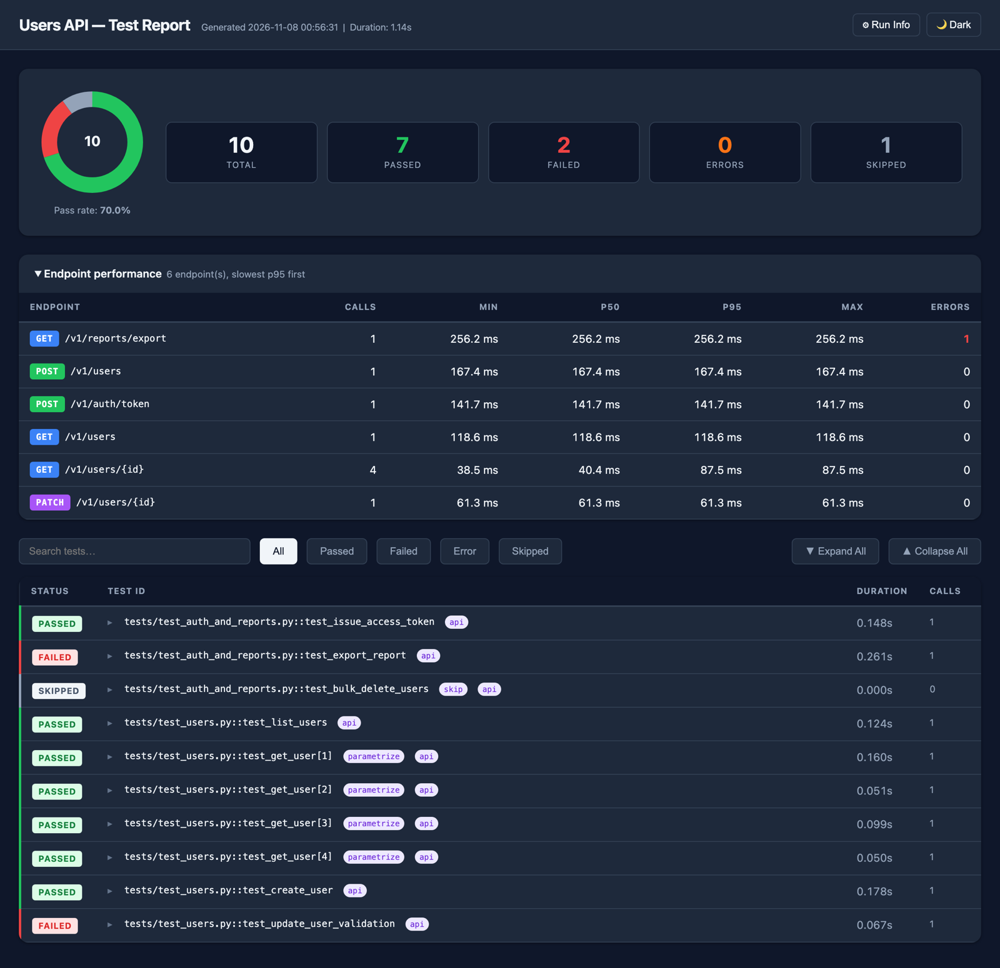
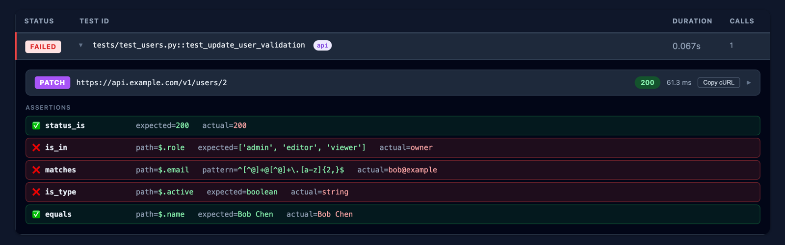
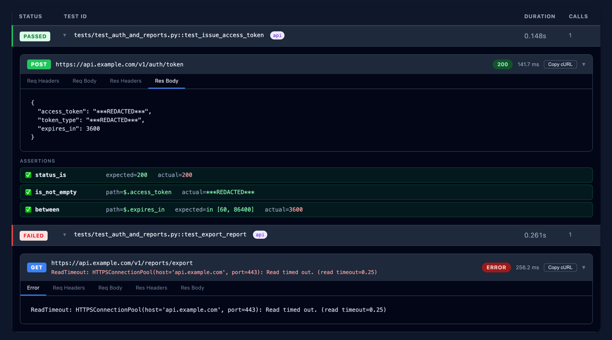
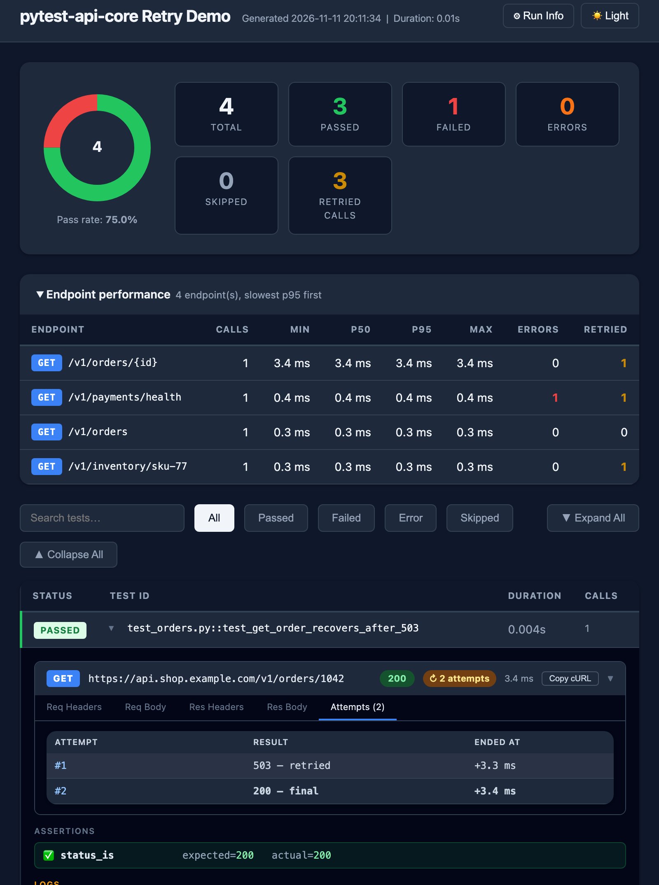

# pytest-api-core

[](https://pypi.org/project/pytest-api-core/)
[](https://pypi.org/project/pytest-api-core/)
[](LICENSE)

> A reusable pytest plugin for API automation — fluent assertions, built-in auth strategies, environment-aware configuration, and a self-contained HTML report.

## Features

- **`APIClient`** — `requests.Session` wrapper with retry, timeout, and structured logging
- **Fluent assertions** — `assert_that(response).status_is(200).json_path("$.id").equals(1)`, plus `json_path` matchers like `is_type`, `contains`, `is_in`, `has_length`, `greater_than`/`less_than`/`between` and `has_path()`
  (`json_path()` supports a small dot/bracket-index subset, not full JSONPath — see [docs/QUICKSTART.md](docs/QUICKSTART.md#json_path-syntax);
  `response_time_under()` measures the whole request including any retries, not just the final attempt)
- **Auth strategies** — Bearer token, Basic, API Key (header/query), OAuth2 client credentials
  (need something else, like an OAuth2 refresh-token flow or signed requests? subclass `AuthBase` — see [docs/QUICKSTART.md](docs/QUICKSTART.md#custom-auth-handlers))
- **Standalone assertion helpers** — `assert_equal`, `assert_contains`, `assert_matches`, `assert_matches_schema`, etc. for values outside an `APIResponse` — see [docs/QUICKSTART.md](docs/QUICKSTART.md#standalone-assertion-helpers)
- **Configurable retry policy** — max attempts, backoff factor, retryable methods and status codes, overridable per environment; every retried attempt is shown in the report (see below)
- **Environment config** — Python `settings.py` classes + `.env` file + env var overrides
- **Soft assertions** — `with soft_assertions():` runs every check and fails once with all the failures listed — see [docs/QUICKSTART.md](docs/QUICKSTART.md#soft-assertions)
- **Custom HTML report** — self-contained file with charts, filterable table, and request/response details,
  a "Copy cURL" button per request (secrets stay redacted), an ERROR banner for timeouts / connection errors,
  a "↻ N attempts" chip and Attempts tab for calls that were retried, and a per-endpoint latency table
  (min/p50/p95/max, errors, retried)
- **Secret redaction** — tokens, passwords, API keys and cookies are masked in logs, assertion messages, and the HTML report (see [Secret redaction](#secret-redaction))
- **Auto-registered fixtures** — zero boilerplate in consuming projects

---

## Report preview

One self-contained HTML file per run (`--api-html-report=reports/report_{timestamp}.html`).
Browse real ones from this repo's CI on the [live reports dashboard](https://githubreports.apicore.subodhsingh.in/).

**Run summary and per-endpoint latency**



**Every assertion as its own row** — here inside `soft_assertions()`, so all three failures are reported in one run, as one error pointing at the test's own code



**Request details, redacted secrets, Copy cURL, and timeouts shown as ERROR**



**Retries are never hidden** — a call that returned 503 and then passed on retry is flagged with "↻ 2 attempts", the Attempts tab lists every try, and the summary and endpoint table count retried calls so flaky endpoints stand out



---

## Installation

```bash
pip install pytest-api-core==1.1.1
```

With `.env` file support (recommended):

```bash
pip install "pytest-api-core[dotenv]==1.1.1"
```

---

## Quick start

```python
# tests/test_posts.py
from pytest_api_core.assertions import assert_that

def test_get_post(api_client):
    response = api_client.get("/posts/1")
    assert_that(response).status_is(200).json_path("$.id").equals(1)

def test_create_post(api_client):
    payload = {"title": "foo", "body": "bar", "userId": 1}
    response = api_client.post("/posts", json=payload)
    assert_that(response).status_is(201).has_key("id")
```

```bash
pytest tests/ --api-env=staging
```

For full setup instructions — including `pytest.ini`, `config/settings.py`, `conftest.py` auth overrides, and CI integration — see **[docs/QUICKSTART.md](docs/QUICKSTART.md)**.

### Template project

Prefer to start from a working example? **[pytest-api-core-template](https://github.com/sksingh329/pytest-api-core-template)** is a ready-to-use consumer project showing the recommended layout — environment settings, `conftest.py` overrides, sample tests, and report configuration. Clone it (or click **Use this template** on GitHub) and point it at your API.

---

## Configuration

### Resolution order (highest → lowest priority)

| Priority | Source |
|---|---|
| 1 | Shell / CI environment variables (`API_BASE_URL`, `API_TOKEN`, …) |
| 2 | `--api-base-url` CLI flag |
| 3 | `ENVIRONMENTS[env]` class in `settings_module` |
| 4 | Built-in defaults (`http://localhost`, timeout 30 s) |

### Retry policy

`APIClient` retries idempotent requests (`GET`, `HEAD`, `OPTIONS`) on `500/502/503/504`
responses and on connection errors, using `urllib3.Retry`. All four knobs follow the same env var → CLI flag →
`settings_module` → built-in default precedence as `base_url`:

| Setting | `settings_module` attribute | CLI flag | Env var | Default |
|---|---|---|---|---|
| Max retry attempts | `api_retry_total` | `--api-retry-total` | `API_RETRY_TOTAL` | `3` |
| Backoff factor | `api_retry_backoff_factor` | `--api-retry-backoff-factor` | `API_RETRY_BACKOFF_FACTOR` | `0.3` |
| Retryable methods | `api_retry_methods` | `--api-retry-methods` (comma-separated) | `API_RETRY_METHODS` (comma-separated) | `GET,HEAD,OPTIONS` |
| Retryable status codes | `api_retry_statuses` | `--api-retry-statuses` (comma-separated) | `API_RETRY_STATUSES` (comma-separated) | `500,502,503,504` |

Backoff factor `0.3` produces sleeps of `0s, 0.3s, 0.6s, 1.2s, ...` between attempts.

**When is a request retried?**

- A response is retried only when **both** its method is in `api_retry_methods` **and** its
  status is in `api_retry_statuses`.
- Connection errors (the request never reached the server) are retried for any method, up to
  `api_retry_total`. Read timeouts are retried only for methods in `api_retry_methods`.
- `429` is not retried by default. Add it to `api_retry_statuses` to retry rate-limited calls;
  urllib3 waits for the `Retry-After` header on `413`/`429`/`503`.
- Only add `POST`/`PATCH` to `api_retry_methods` if the API makes repeats safe (e.g. an
  `Idempotency-Key` header). Otherwise a retry can create duplicate records.
- Avoid adding client errors such as `400`/`404` to `api_retry_statuses`. Retrying them hides
  real bugs instead of reporting them.

**Retries are never hidden.** A call that fails and then passes on a retry is still reported:

- each retried attempt logs a WARNING line, e.g. `↻ GET https://…/orders  503  — attempt 1 failed, retrying`
- the call's banner in the HTML report shows a `↻ 2 attempts` chip, and an **Attempts** tab lists
  each attempt's status (or connection error) and when it ended
- the summary shows a **Retried calls** count and the endpoint table a **Retried** column, so
  flaky endpoints stand out even when every test passed

Example — a flakier staging environment gets more retries and a longer backoff:

```python
# settings.py
class StagingSettings(BaseSettings):
    base_url = "https://api.staging.mycompany.com"
    api_retry_total = 5
    api_retry_backoff_factor = 1.0
    api_retry_statuses = [429, 502, 503, 504]   # also retry rate limiting
```

Or per-run, without touching code:

```bash
pytest tests/ --api-env=staging --api-retry-total=5 --api-retry-backoff-factor=1.0
pytest tests/ --api-retry-methods=GET,HEAD,OPTIONS,PUT --api-retry-statuses=429,502,503,504
```

Or in CI, with env vars (these override everything else):

```bash
export API_RETRY_METHODS=GET,HEAD,OPTIONS,PUT
export API_RETRY_STATUSES=429,502,503,504
```

**Different policy for one group of endpoints.** The policy applies to a whole client, not
to single requests. If some endpoints need different rules, build a second client in your
`conftest.py`:

```python
import pytest
from pytest_api_core.client.api_client import APIClient

@pytest.fixture(scope="session")
def payments_client(api_config, auth_provider):
    client = APIClient(
        base_url=api_config["base_url"],
        auth=auth_provider,
        retry_methods=["GET", "POST"],  # POST is safe here: the API honours Idempotency-Key
        retry_statuses=[503],
        retry_total=2,
    )
    yield client
    client.close()
```

For full control, pass a urllib3 policy as `retry=Retry(...)`. A plain `Retry` is converted
automatically, so its attempts still appear in the report. To keep that for a `Retry` subclass,
subclass `pytest_api_core.client.api_client.RecordingRetry` instead.

To disable retries entirely, pass `retry=None` directly when constructing an
`APIClient` yourself (not available as a config option, since "no retries" isn't
something you'd want to toggle per environment).

### Key `pytest.ini` options

| Option | Description | Default |
|---|---|---|
| `api_env` | Active environment name | `dev` |
| `api_settings_module` | Dotted path to your settings module | — |
| `api_dotenv_file` | Path to `.env` file | `.env` |
| `api_log_level` | Framework log level | `WARNING` |
| `api_html_report` | HTML report path (supports `{env}`, `{timestamp}`) | — |
| `api_html_theme` | Report theme: `light` or `dark` | `dark` |
| `api_html_title` | Report browser tab title | `API Test Report` |
| `api_html_header` | Report page header text | `API Test Report` |
| `api_redact_keys` | Extra header/JSON/query keys to redact (one per line) | — |

### CLI flags

| Flag | Description |
|---|---|
| `--api-env` | Override active environment |
| `--api-base-url` | Override `base_url` |
| `--api-log-level` | Override framework log level |
| `--api-html-report` | Override HTML report path |
| `--api-retry-total` | Override max retry attempts (default: `3`) |
| `--api-retry-backoff-factor` | Override retry backoff factor (default: `0.3`) |
| `--api-retry-methods` | Override retryable HTTP methods, comma-separated (default: `GET,HEAD,OPTIONS`) |

---

## Fixtures

All fixtures are auto-registered — no imports needed in `conftest.py`.

| Fixture | Scope | Description |
|---|---|---|
| `api_config` | session | Resolved config dict for the active env |
| `auth_provider` | session | Auth strategy passed to `api_client` — override this alone to swap auth |
| `api_client` | session | Configured `APIClient` instance, depends on `auth_provider` |
| `api_bearer_auth` | function | `BearerAuth` from `API_TOKEN` env var |
| `api_basic_auth` | function | `BasicAuth` from `API_USERNAME` / `API_PASSWORD` |
| `api_key_auth` | function | `APIKeyAuth` from `API_KEY_NAME` / `API_KEY_VALUE` |

Override `auth_provider` in your project's `conftest.py` to inject custom auth without
redeclaring `api_client` — see [docs/QUICKSTART.md](docs/QUICKSTART.md#7-override-auth--testsconftestpy).

---

## Secret redaction

Credentials never reach the raw logs (terminal, `log_cli`, `log_file`), assertion failure
messages, or the HTML report — they are replaced with `***REDACTED***`. Redaction is on by
default and works in three layers:

1. **By key name** — values under any header, JSON key, query/form parameter, or `json_path`
   segment whose name contains `token`, `secret`, `password`, `passwd`, `apikey`,
   `authorization`, `cookie`, `credential`, or `privatekey` (case-insensitive, `-`/`_` ignored)
   are masked. This covers `Authorization`, `X-API-Key`, `Set-Cookie`, `access_token`,
   `client_secret`, `?api_key=…`, and so on.
2. **By known value** — secrets the framework knows about are scrubbed wherever they appear,
   even under an innocuous key: values passed to `BearerAuth`, `BasicAuth`, `APIKeyAuth`,
   `OAuth2ClientCredentials` (including fetched access tokens), sensitive `default_headers`, and
   the `API_TOKEN` / `API_PASSWORD` / `API_KEY_VALUE` env vars. `Bearer`/`Basic` credentials and
   JWTs are always scrubbed from free text.
3. **Final pass** — framework and urllib3 log lines, plus captured logs, stdout/stderr, and
   tracebacks in the HTML report, are scrubbed before being written.

Assertions on sensitive fields still work normally — only what is *displayed* is masked:

```python
assert_that(response).json_path("$.access_token").is_not_none()   # report shows ***REDACTED***
assert_that(response).header_equals("X-Auth-Token", expected_token)
```

### Extending redaction

```ini
# pytest.ini — extra key names to treat as sensitive
[pytest]
api_redact_keys =
    x-tenant-signature
    otp
```

```python
# conftest.py — register a secret obtained at runtime, or add keys programmatically
from pytest_api_core import add_sensitive_keys, register_secret

register_secret(session_token)          # scrubbed everywhere from now on
add_sensitive_keys("x-tenant-signature")
```

Standalone helpers don't know key names, so pass `sensitive=True` to mask their values:

```python
assert_is_not_empty(token, sensitive=True)
assert_equal(actual_secret, expected_secret, sensitive=True)
```

**Notes**

- Masking is deliberately conservative: a key like `token_type` is masked too.
- Registered secrets shorter than 4 characters are ignored, to avoid mangling unrelated output.
- Plain `assert` statements are reported by pytest itself (assertion introspection), which the
  framework can't intercept — prefer `assert_that(...)` / the `assert_*` helpers for secret
  values, or `register_secret()` them so they're scrubbed from the HTML report.

---

## Project structure

```
pytest-api-core-framework/
├── src/pytest_api_core/
│   ├── plugin.py               # pytest11 entry point — CLI/ini options, .env loading, reporter registration
│   ├── assertions/
│   │   ├── response_assertions.py   # assert_that(response) fluent chain
│   │   └── assert_utils.py          # standalone helpers: assert_equal, assert_contains, ...
│   ├── auth/
│   │   └── auth_handlers.py    # BearerAuth, BasicAuth, APIKeyAuth, OAuth2ClientCredentials
│   ├── client/
│   │   ├── api_client.py       # APIClient (requests.Session wrapper, retry, __API_CALL__ logging)
│   │   └── api_response.py     # APIResponse wrapper (adds elapsed_ms)
│   ├── config/
│   │   ├── base_settings.py    # BaseSettings — subclass to define environments
│   │   ├── config_manager.py   # ConfigManager — merges env vars / CLI / settings_module / defaults
│   │   └── env_loader.py       # .env file loading
│   ├── fixtures/
│   │   └── api_fixtures.py     # api_config, auth_provider, api_client, api_*_auth fixtures
│   ├── reporters/
│   │   ├── html_reporter.py    # parses __API_CALL__/__API_ASSERT__ sentinels, renders HTML report
│   │   └── templates/report.html
│   └── security/
│       └── redaction.py        # secret masking for logs, sentinels, assertion messages, report
├── tests/
│   ├── unit/test_unit.py       # mocked HTTP tests (responses library)
│   └── e2e/test_e2e_jsonplaceholder.py  # live tests against jsonplaceholder.typicode.com
├── docs/QUICKSTART.md          # full setup guide (settings.py, conftest.py, CI)
├── config/settings.py          # example ENVIRONMENTS settings module
└── pyproject.toml
```

---

## License

See [LICENSE](LICENSE).
